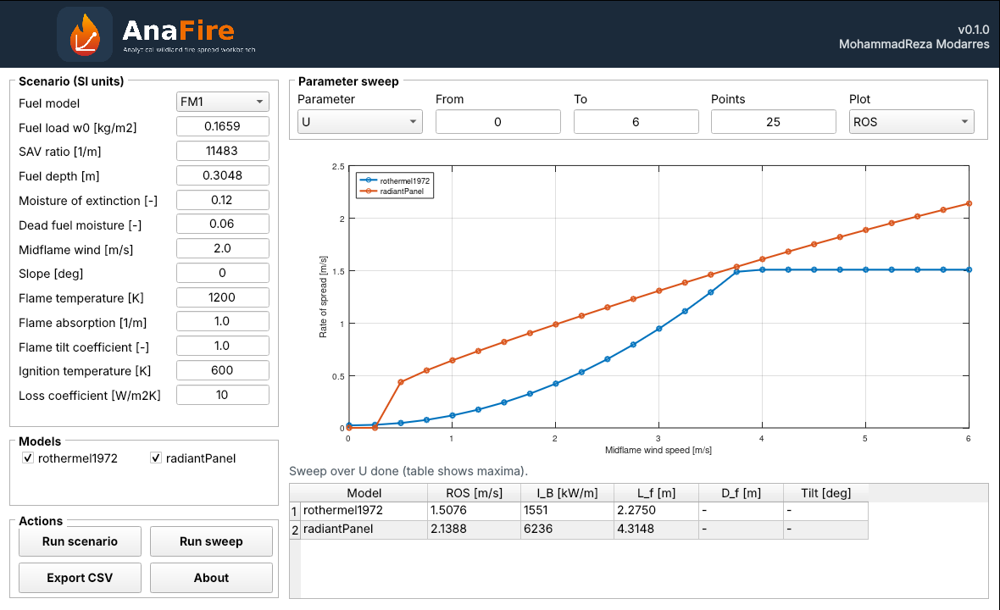

<p align="center"></p>

# AnaFire
   [](https://doi.org/10.5281/zenodo.24011764)

**An analytical wildland fire spread workbench with a graphical interface**

**Developer:** MohammadReza Modarres ([ORCID 0000-0003-4201-0875](https://orcid.org/0000-0003-4201-0875))

AnaFire runs analytical and quasi-physical surface fire spread models under one
SI input standard, so they can be compared side by side. In the interface you can:

- define a fuel bed (standard grass fuel models or custom values), wind, slope and moisture;
- run selected models for one scenario: rate of spread, fireline intensity, flame length, depth and tilt;
- sweep any input parameter and plot the response of every model;
- export results to CSV.



## Models in v0.1.0

| Model | Description |
|---|---|
| `rothermel1972` | Rothermel (1972) surface spread model with the Albini (1976) revision; reference baseline |
| `radiantPanel` | Radiative heat-balance model: tilted planar flame, 2-D view factor, critical-flux loss closure |

## Installation

**Option A — with MATLAB (R2022a or later, no toolboxes needed)**

1. Download `AnaFire_v0.1.0_MATLAB.zip` from the Releases page or the Zenodo record and unzip it.
2. In MATLAB, go to the unzipped folder and run:
   ```matlab
   anafire_setup
   AnaFireApp
   ```

**Option B — without MATLAB (Windows desktop app)**

1. Download `AnaFire_v0.1.0_Installer.exe`.
2. Run it. The installer downloads the free MATLAB Runtime if it is not already installed.
3. Start AnaFire from the Start menu.

## Citation

If you use AnaFire, please cite the Zenodo record (DOI on the badge above / in `CITATION.cff`).

## License

Free for research, teaching and non-commercial use under the AnaFire End User
License (`LICENSE`). The source code is not distributed.

© 2026 MohammadReza Modarres
